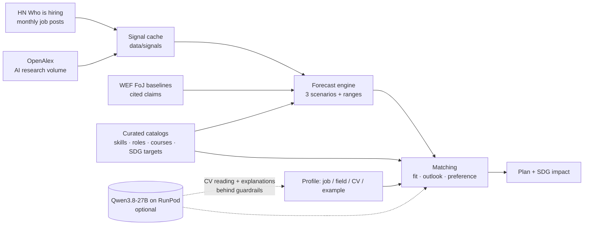

# Path.AI: find your path in the AI era

Path.AI takes a person from **"who I am today"** to **"where I can be in the AI era"**. A first result takes one tap with an example, or about four taps on your own profile. It reads live job-market and AI-research signals, estimates which skills are rising or declining under three AI-disruption scenarios, ranks future roles with an explainable match, and builds a free or low-cost learning plan. Each skill in the plan has a **free micro-course** (3 lessons + a quiz), and passing the quiz earns a **verifiable Path.AI certificate**. Every role and skill is linked to concrete UN SDG targets.

> SDC XMUM Hackathon 2026, Domain 1 (Aiversecity Future-Ready Workforce). Working prototype. Every example person is fictional.


## Who it is for

**Primary user.** A Malaysian working adult in a high-AI-exposure job, such as an accounts clerk, admin assistant, cashier, customer-service agent or graphic designer, at the moment their employer starts automating with AI. MOSTI estimates that 600,000+ workers need reskilling within 3–5 years. Hays (2025) reports that 56% of Malaysian professionals use AI at work but only 26% have been trained.

**Also serves:**
- students and fresh graduates;
- HR and L&D teams, through a team heatmap;
- career centres, through shareable links and a printable plan.

## The journey: three short steps, few decisions per screen

| Screen | What the user does |
|---|---|
| **Home** | One clear action: **Get started**. Alternatives are *Upload my CV* or *Try an example* (one tap to full results). |
| **Step 1 · What do you do today?** | Type or tap a job. Popular jobs are one tap away, and *Student / fresh graduate* asks for a field of study. Uploading a CV works here too. |
| **Step 2 · Here's what you're good at** | Skills are **pre-filled** from the job, field or CV. Tap to remove, or tap a suggested skill to add it. |
| **Step 3 · What matters to you?** | Optional interest tiles (they map to SDG goals) and weekly learning time. Then **Show my matches**. |
| **Results** | Three role cards, each with **skills match**, **demand per year**, **time to get job-ready**, a *Holds up in every scenario* badge and SDG badges. Details sit behind *Why this role?*. One switch, *If AI changes work: slower / as expected / faster*, controls the scenario. |
| **Plan** | Numbered steps, each with **Learn here · ~13 min** (the Path.AI micro-course) and one recommended external course. *Mark as done* tracks progress, and a certified skill is ticked off automatically. Alternatives, credentials and practice projects are folded behind *More options*. The page ends with SDG impact and Malaysian support channels (HRD Corp, MYFutureJobs, MyMahir). |
| **Learn** | 44 free micro-courses, one per skill, recommended from the user's plan. Each course is 3 short lessons and then a 5-question quiz. Pass with 4 or more correct, enter a name, and get a **Path.AI certificate** to download as PDF or share as a verification link. |

Secondary pages are **Explore trends** (Future Skills Radar, AI capability pulse, data-as-of time machine, sources), **For teams** (HR heatmap) and **How it works** (methodology).

**Design.**
- Light, calm look based on the College Board palette: royal blue `#324dc7`, ink `#1e1e1e`, gray page `#f0f0f0`, white rounded cards, pill buttons, and a dark footer with a yellow rule.
- Roboto type and responsive down to 390 px.
- English by default; Bahasa Melayu and 中文 are in the footer.


## How each must-have feature is delivered

| Must-have | Implementation | Code |
|---|---|---|
| 1. Skills profile intake | Job picker with pre-filled skills (35 roles with O*NET codes), field of study, or CV upload (PDF/TXT) with rule-based detection. The LLM adds skills only with a verbatim CV quote. Every skill stays editable. | `static/app.js`, `app/engine/profile.py`, `app/llm/tasks.py` |
| 2. AI-trend signal layer | **Live and updatable.** (a) Job posts from 36 monthly *HN "Who is hiring?"* threads: 11,583 posts, Nov 2023 – Oct 2026. (b) AI-research volume per capability from **OpenAlex**, half-years 2024H1–2026H1. Plus cited WEF *Future of Jobs* 2025/2023 baselines. Each value carries its source and fetch date. Refresh it from *Explore trends* or with `python -m app.signals.refresh`. | `app/signals/` |
| 3. Future-role matching | Fit (direct plus capped transferable credit), outlook, and preferences. The user can re-weight them, and the current job is never recommended back. Roles come only from a catalog with O*NET codes and WEF categories. | `app/engine/matching.py` |
| 4. Reskilling pathway | Prerequisites first, then core skills, with quick wins early. Hours and weeks are computed at the user's weekly time. Every step has an in-app micro-course with a quiz and certificate, plus 90 external courses with live-checked links, labelled free, free-to-audit, low-cost or paid (check HRD Corp). | `app/engine/pathway.py`, `app/learn.py`, `data/learn/` |
| 5. SDG mapping | Every role and skill maps to specific **SDG targets** (e.g. 7.2, 8.5, 12.6), each with a reason and a direct or enabling strength. Interest tiles carry SDG priorities that re-rank roles, and the plan shows its SDG impact. | `data/catalog/*.json` |
| 6. Handling uncertainty | Three scenarios: slower ×0.5, expected ×1, faster ×2 AI pace. Every estimate has a range and a confidence label, and roles are flagged when they hold up in every scenario. Trend data can be viewed *as of* any of the last 19 months. "Estimates, not predictions" wording appears everywhere. | `app/engine/forecast.py` |

## How trend signals become skill forecasts

For every skill *s* and scenario *k* (annual log-growth of demand):

```
growth[s,k] = 0.4 × job-post momentum_s                     (HN: share of posts mentioning s, last 6 months vs a year earlier;
                                                             clipped ±0.6, empirical-Bayes shrinkage for small counts)
            + 0.04 × [a cited WEF claim says s is rising]   (baseline)
            + pace_k × Σ_c sensitivity[s,c] × (1 + capability momentum_c)
                                                            (OpenAlex: YoY change of topic c's share of AI research)
```

- **Sensitivities.** Negative for substitution (data entry vs. document AI), positive for complementarity (GenAI app development vs. LLMs and agents). They are explicit, editable team assumptions informed by the ILO 2025 exposure index and WEF 2025 (`data/catalog/skills.json`).
- **Role outlook.** The importance-weighted mean of the role's skills, plus a WEF role prior and a small role-title job-post term.
- **HN coverage.** HN is a global, tech-centric job board, so it is used **only for tech skills**. The other skills rely on baselines and AI signals and are labelled *low confidence*.
- **Constants.** All model constants live in `data/catalog/capabilities.json` and are shown on *How it works*.




## Learn: free micro-courses and Path.AI certificates

Every one of the 44 skills has a course: 132 lessons and 220 quiz questions in all. Each lesson has four parts:

1. **Why it matters.** A short Path.AI note on the career relevance.
2. **Read.** An excerpt from an openly licensed source. Today that is the lead section of a Wikipedia article (**CC BY-SA 4.0**). It shows the article title, a link to the *exact revision* used, the licence, and a "shortened" flag when the excerpt was cut.
3. **Try it.** A practical activity to do at work or at home.
4. **Next lesson.** A button that marks the lesson done.

The **quiz** has 5 questions, and every question can be answered from the course's lessons. The pass mark is 4 of 5. Answers are graded **on the server**, so the answer key never reaches the browser. A failed attempt shows only which lessons to review, never the right answers, so a retake still tests the learner.

**Certificates.**
- **What it says.** The learner's name, the course, the score, the date and an ID such as `PAI-CWKF-OXIP`.
- **How it is verified.** Each certificate is signed with HMAC-SHA256 (`CERT_SECRET`). Anyone can open its link `/#/certificate/<token>` to verify it, and a tampered link fails.
- **Privacy.** No database of names is kept; the name lives only inside the signed link.
- **Formats.** It prints as a single A4 landscape PDF.
- **Status.** Each certificate states clearly that it confirms a free micro-course and is **not an accredited qualification**.

**Content pipeline.** `scripts/build_learn_content.py` fetches the excerpts through the MediaWiki API with attribution metadata and stores them in `data/learn/excerpts.json`, so the demo works offline. Formulas and lists are cleaned up for reading. Lesson notes, activities and quizzes are in `data/learn/courses/*.json`. Licensing is described in `data/learn/LICENSE.md`.


## Guardrails: nothing is invented

- **Jobs** come only from `roles.json` (O*NET codes and WEF categories).
- **Courses** come only from `resources.json`, where every URL is checked by `scripts/verify_resources.py`. If no course exists, the plan says *"No verified course in our list yet — ask a career counsellor"*.
- **The LLM never chooses jobs, courses or numbers.**
  - CV reading is JSON-schema constrained to our skill ids, and each skill must quote the CV verbatim or it is dropped.
  - Explanations must cite existing sources and may contain only numbers from the fact sheet; otherwise the verified text is shown.
  - Both rules are tested against a fake vLLM endpoint (`tests/test_guardrails.py`).
- **Fairness.** The only inputs are skills, interests, SDG priorities and weekly hours. A test proves that adding age, gender, ethnicity or location cannot change the ranking.
- **Human-centred.** Every skill can be edited and the ranking re-weighted. Path.AI supports career decisions; it does not make hiring decisions.

## Language model and GPU

- **Model.** `Qwen/Qwen3.8-27B-FP8`: open weights (Apache-2.0, Aug 2026), multilingual (EN/BM/ZH), vision-capable, fits one 48 GB GPU.
- **GPU.** 1× **RTX A6000 48 GB** on RunPod: $0.59/h Secure, $0.33/h Community, about 40 hours for $25.
- **Without the model.** The app works fully **without** it. Only CV reading and the *Rewrite with AI* explanations use it.
- **Details.** Reasoning, alternatives, budget plan and setup are in **[docs/RUNPOD.md](docs/RUNPOD.md)**.

## Hardest risks and fallbacks

| Risk | Mitigation |
|---|---|
| Trend data unreliable or unavailable during the demo | Signals are cached in the repo with fetch dates. Refresh is incremental and keeps the last good data on failure. There are two independent live sources plus cited baselines, and OpenAlex use is budget-aware. |
| AI inventing jobs, courses or statistics | Catalog-only ids, evidence and number guardrails, and tests. |
| Matching quality | Transparent components, transferable-skill credit, editable skills and weights, and robustness across scenarios. |
| GPU or LLM down | Full rule-based mode. The UI states which engine wrote each explanation. |
| Representativeness (HN is US/tech-centric) | Used for tech skills only, with confidence labels. Malaysian feeds are on the roadmap. |

## Run it

```bash
python3 -m venv .venv && source .venv/bin/activate      # Python ≥ 3.11
pip install -r requirements.txt
uvicorn app.main:app --reload                            # http://127.0.0.1:8000
python -m pytest -q                                      # 50 tests
python -m app.signals.refresh                            # pull fresh HN + OpenAlex data (optional)
python scripts/verify_resources.py                       # re-check every course / source URL
python scripts/build_learn_content.py                     # (re)fetch lesson readings with attribution
```

- **Replit.** Import the GitHub repo. `.replit` installs the requirements and runs uvicorn on port 8000.
- **LLM.** Copy `.env.example` to `.env` and set `LLM_BASE_URL`, `LLM_API_KEY` and `LLM_MODEL`.
- **Certificates.** In production, set a stable `CERT_SECRET`.

**Demo links** (one tap to a full result):

| Link | Opens |
|---|---|
| `/#/results?persona=aisyah` | Accounts clerk → automation, finance and data roles |
| `/#/results?persona=weijie` | Engineering graduate → EV, solar and renewable-energy roles |
| `/#/results?persona=kavitha&pace=fast` | Contact-centre lead, under fast AI disruption |
| `/#/plan/automation_specialist?persona=aisyah` | A full learning plan |
| `/#/learn` · `/#/learn/prompt_eng` | Course catalogue · a micro-course with quiz and certificate |
| `/#/trends?asof=2025-10` | Trends as of an earlier month (time machine) |
| `/#/teams` | HR heatmap |
| any link + `&lang=ms` or `&lang=zh` | Same page in Bahasa Melayu or 中文 |


## Project structure

```
app/
  main.py              FastAPI API + static web app
  catalog.py           loads & validates the curated catalogs
  signals/             live sources: hn.py (job posts), openalex.py (AI research), refresh.py
  engine/              forecast.py · matching.py · pathway.py · explain.py · profile.py
  llm/                 OpenAI-compatible client (vLLM / RunPod) + guarded tasks
  learn.py             micro-courses, server-side quiz grading, signed certificates
data/
  catalog/             skills · roles (+ interest tiles, study fields) · resources · sdgs · capabilities · sources
  signals/             cached, dated trend data (refreshable)
  learn/               courses/*.json (lessons + quizzes) · excerpts.json (CC BY-SA readings) · LICENSE.md
  personas.json        fictional example people + fictional HR team
static/                vanilla-JS single-page app (no build step): app.js · learn.js · core.js · charts.js · i18n.js · styles.css
tests/                 catalog, engine, guardrail, learn/certificate and API tests
docs/RUNPOD.md         model + GPU choice and deployment guide
```

## Limitations and roadmap

- Malaysian job-posting feeds (e.g. MYFutureJobs / MyMahir partnerships), DOSM labour statistics and HRD Corp programme data, so that non-tech skills also get live market signals.
- Research attention is a proxy for AI progress, not a measure of real-world adoption. Adoption signals could be added.
- Sensitivities are expert assumptions. They should be calibrated against observed job-post changes as more history accumulates.
- Role summaries and lessons are English-only for now. Image-CV intake is possible because the model is vision-capable.
- Lessons are short introductions. Longer open courses (Microsoft *for Beginners* repos under MIT, The Carpentries under CC BY 4.0, OpenStax under CC BY 4.0) could be added as extra lessons.

## Data and AI disclosure

- **Data.** Public or open data and fictional example people only. No real CVs or personal data are stored. Job posts are kept as aggregate counts only. Lesson readings are attributed Wikipedia excerpts (CC BY-SA 4.0).
- **Language model.** Qwen3.8-27B (open weights) when configured. Otherwise the app runs fully rule-based, and the UI says which engine wrote each explanation.
- **Estimates.** All forecasts are estimates, not predictions. People decide.
