<p align="center">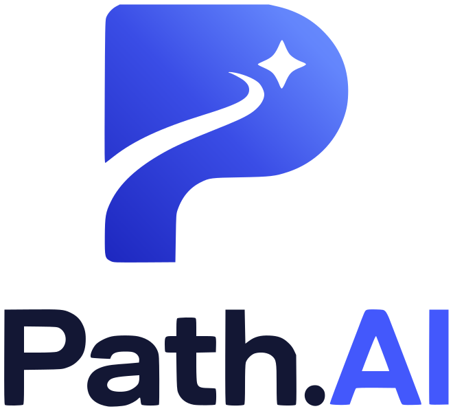</p>

# Path.AI: find your path in the AI era

Path.AI takes a person from **"who I am today"** to **"where I can be in the AI era"**. A first result takes one tap with an example, or about four taps on your own profile. It reads live job-market and AI-research signals, estimates which skills are rising or declining under three AI-disruption scenarios, ranks future roles with an explainable match, and builds a free or low-cost learning plan. Each skill in the plan has a **free, full course** built from real chapters of open curricula (Microsoft *for Beginners*, The Carpentries, OpenStax, BCcampus, GOV.UK, NIST, EIA, EPA and more), studied chapter by chapter: a short test after every chapter unlocks the next one, and passing the final test earns a **verifiable Path.AI certificate**. The last step, **Opportunities**, asks two questions: *study or work?* and *where?* It then lists open jobs anywhere in the world, ranked by the same explainable match, or the universities of the chosen country with how to apply and how to fund it. Every role and skill is linked to concrete UN SDG targets.

> SDC XMUM Hackathon 2026, Domain 1 (Aiversecity Future-Ready Workforce). Working prototype. Every example person is fictional.

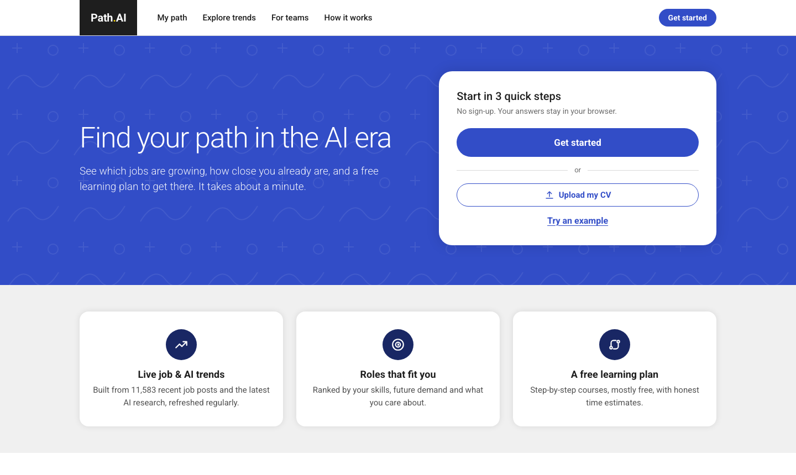

## Who it is for

**Primary user.** A Malaysian working adult in a high-AI-exposure job, such as an accounts clerk, admin assistant, cashier, customer-service agent, graphic designer or production operator, at the moment their employer starts automating with AI. MOSTI estimates that 600,000+ workers need reskilling within 3–5 years. Hays (2025) reports that 56% of Malaysian professionals use AI at work but only 26% have been trained.

**Also serves:**
- students and fresh graduates;
- HR and L&D teams, through a team heatmap;
- career centres, through shareable links and a printable plan.

## The journey: three short steps, few decisions per screen

| Screen | What the user does |
|---|---|
| **Home** | One clear action: **Get started**. Alternatives are *Upload my CV* or *Try an example* (one tap to full results). |
| **Step 1 · What do you do today?** | Type or tap a job. Popular jobs are one tap away, and *Student / fresh graduate* asks for a field of study. Uploading a CV works here too. |
| **Step 2 · Here's what you're good at** | Skills are **pre-filled** from the job, field or CV. Tap to remove, or tap a suggested skill to add it. |
| **Step 3 · What matters to you?** | Optional interest tiles (they map to SDG goals) and weekly learning time. Then **Show my matches**. |
| **Results** | Three role cards, each with **skills match**, **demand per year**, **time to get job-ready**, a *Holds up in every scenario* badge and SDG badges. Details sit behind *Why this role?*. One switch, *If AI changes work: slower / as expected / faster*, controls the scenario. |
| **Plan** | Numbered steps, each with **Free course · 2.2 h** (the in-app Path.AI course) and one recommended external course. *Mark as done* tracks progress, and a certified skill is ticked off automatically. Alternatives, credentials and practice projects are folded behind *More options*. The page ends with SDG impact and Malaysian support channels (HRD Corp, MYFutureJobs, MyMahir). |
| **Learn** | 53 full courses, one per skill (755 lessons, about 109 hours of reading), recommended from the user's plan. A catalogue with search and categories, a course page with syllabus, a lesson player with outline and progress, a 5-question test after every chapter (4 correct unlocks the next chapter) and a 25-question final test (20 correct to pass). Pass, enter a name, and get a **Path.AI certificate** to save as PDF or share as a verification link. |
| **Opportunities** | Two questions: **Study or Work**, then **where** (any country, or *Remote — from anywhere* for work). **Work:** open jobs grouped *Ready to apply / Close — a little learning first / A stretch for now*. Each job shows the skills you have and the skills to learn, with hours and a link to the Path.AI course, and *View & apply* opens the employer's page. Pre-filled searches on the country's main job sites are one tap away. **Study:** the country's universities, a *Find programmes* search for the degree field that leads to your path, how to apply, funding and free courses to prepare. |

Secondary pages are **Explore trends** (Future Skills Radar, AI capability pulse, data-as-of time machine, sources), **For teams** (HR heatmap) and **How it works** (methodology).

**Design.**
- Light, calm look based on the College Board palette: royal blue `#324dc7`, ink `#1e1e1e`, gray page `#f0f0f0`, white rounded cards, pill buttons, and a dark footer with a yellow rule.
- Roboto type and responsive down to 390 px.
- English by default; Bahasa Melayu and 中文 are in the footer.

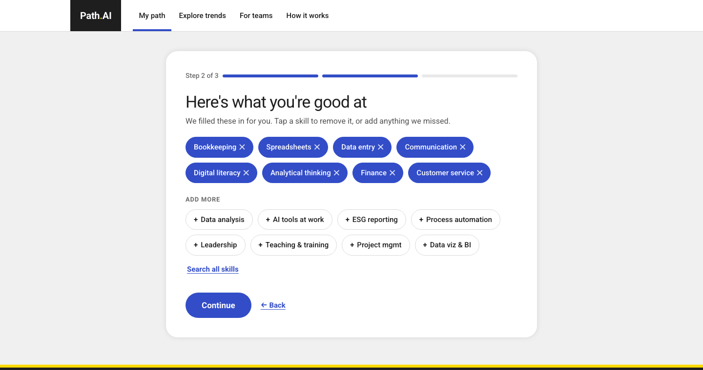
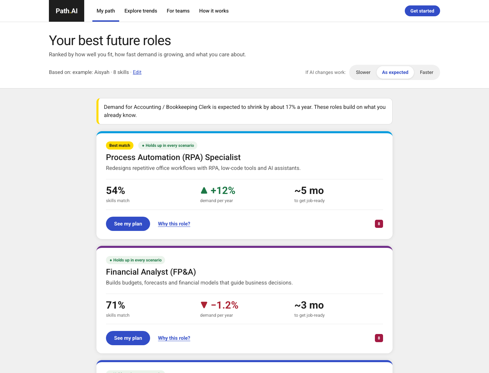

## How each must-have feature is delivered

| Must-have | Implementation | Code |
|---|---|---|
| 1. Skills profile intake | Job picker with pre-filled skills (63 roles with O*NET codes: 43 future roles and 20 jobs people do today), field of study, or CV upload (PDF/TXT) with rule-based detection. The LLM adds skills only with a verbatim CV quote. Every skill stays editable. | `static/app.js`, `app/engine/profile.py`, `app/llm/tasks.py` |
| 2. AI-trend signal layer | **Live and updatable.** (a) Job posts from 36 monthly *HN "Who is hiring?"* threads: 11,583 posts, Nov 2023 – Oct 2026. (b) AI-research volume per capability from **OpenAlex**, half-years 2024H1–2026H1. Plus cited WEF *Future of Jobs* 2025/2023 baselines. Each value carries its source and fetch date. Refresh it from *Explore trends* or with `python -m app.signals.refresh`. | `app/signals/` |
| 3. Future-role matching | Fit (direct plus capped transferable credit), outlook, and preferences. The user can re-weight them, and the current job is never recommended back. Roles come only from a catalog with O*NET codes and WEF categories. | `app/engine/matching.py` |
| 4. Reskilling pathway | Prerequisites first, then core skills, with quick wins early. Hours and weeks are computed at the user's weekly time. Every step opens with the in-app Path.AI course (chapter tests, final test, certificate), with an external course offered as the alternative; 102 external courses with live-checked links, labelled free, free-to-audit, low-cost or paid (check HRD Corp). | `app/engine/pathway.py`, `app/learn.py`, `data/learn/` |
| 5. SDG mapping | Every role and skill maps to specific **SDG targets** (e.g. 7.2, 8.5, 12.6), each with a reason and a direct or enabling strength. Interest tiles carry SDG priorities that re-rank roles, and the plan shows its SDG impact. Every goal badge, wherever it appears, opens a short explainer. It gives the goal's meaning in plain words and its official wording (EN/MS/ZH), and says how the role or skill you clicked contributes. It also lists the targets Path.AI links to, the jobs and free courses that contribute, and a link to the UN page. | `data/catalog/*.json`, `static/core.js` |
| 6. Handling uncertainty | Three scenarios: slower ×0.5, expected ×1, faster ×2 AI pace. Every estimate has a range and a confidence label, and roles are flagged when they hold up in every scenario. Trend data can be viewed *as of* any of the last 19 months. "Estimates, not predictions" wording appears everywhere. | `app/engine/forecast.py` |

## How trend signals become skill forecasts

For every skill *s* and scenario *k* (annual log-growth of demand):

```
growth[s,k] = 0.4 × job-post momentum_s                     (HN: share of posts mentioning s, last 6 months vs a year earlier;
                                                             clipped ±0.6, empirical-Bayes shrinkage for small counts)
            + 0.04 × [a cited WEF claim says s is rising]   (baseline)
            + pace_k × Σ_c sensitivity[s,c] × (1 + capability momentum_c)
                                                            (OpenAlex: YoY change of topic c's share of AI research)
```

- **Sensitivities.** Negative for substitution (data entry vs. document AI), positive for complementarity (GenAI app development vs. LLMs and agents). They are explicit, editable team assumptions informed by the ILO 2025 exposure index and WEF 2025 (`data/catalog/skills.json`).
- **Role outlook.** The importance-weighted mean of the role's skills, plus a WEF role prior and a small role-title job-post term.
- **HN coverage.** HN is a global, tech-centric job board, so it is used **only for tech skills**. The other skills rely on baselines and AI signals and are labelled *low confidence*.
- **Constants.** All model constants live in `data/catalog/capabilities.json` and are shown on *How it works*.

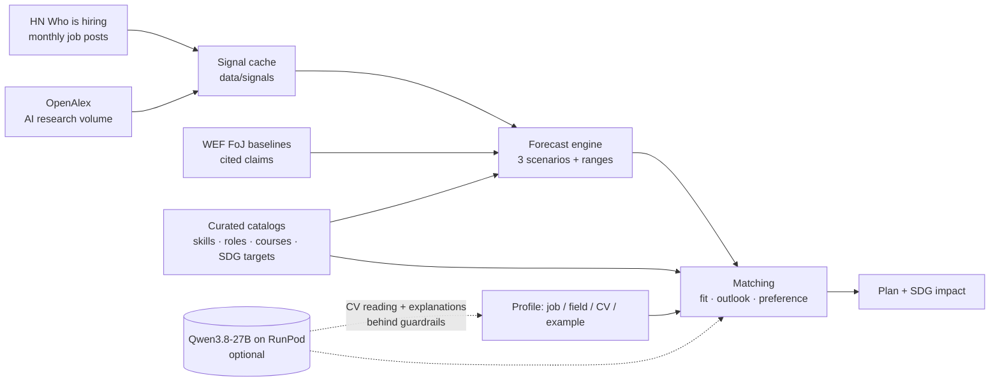

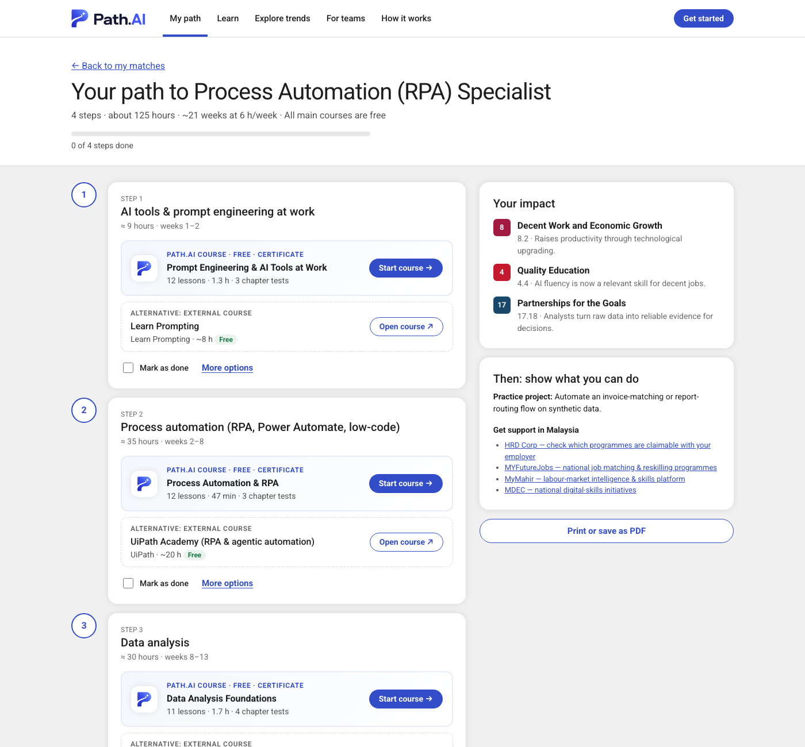

## Learn: full open courses and Path.AI certificates

Every one of the 53 skills has a **full course**: 755 lessons and about 109 hours of reading in all. Lessons are real chapters, episodes and guides from openly licensed curricula, kept whole and re-typeset, never paraphrased:

- **Sources.** Microsoft *for Beginners* curricula (MIT), Security-101 (CC0), The Carpentries (CC BY 4.0), OpenStax *Introduction to Business* and BCcampus, Open Oregon, eCampusOntario and other open textbooks (CC BY / CC BY-SA), *Technical Writing Essentials* (CC BY 4.0), GOV.UK Service Manual and guidance (Open Government Licence), NIST, NIST/SEMATECH, EIA, EPA, DOE, OSHA, SBA, FinCEN, HealthIT and IRS (U.S. public domain), Google developer docs and *Technical Writing One* (CC BY 4.0), *Lessons In Electric Circuits* (Design Science License) and more. No non-commercial (NC) material is used; OpenStax's newer business titles are CC BY-NC-SA, so only its CC BY *Introduction to Business* is used.
- **Every lesson** shows its source, licence and attribution, with a link to the original. GitHub sources are pinned to the exact commit imported (`data/learn/pins.json`).
- **The lesson player** has a course outline, an "On this page" table of contents, reading time and *Complete & continue*. Progress stays in the browser.

**Tests.** Every chapter ends with a 5-question test; 4 correct answers unlock the next chapter. The **final test** has 25 questions drawn from the whole course, spread over every chapter; 20 correct earn the certificate. Each attempt is a fresh random draw from the course's question pool (1,966 questions in all, at least 6 per chapter and 30 per course), and a retake prefers questions the learner has not just seen. Questions come from the open quiz banks that ship with the source curricula (216), or are written for Path.AI (1,750); each authored question carries a word-for-word quote from a lesson, and the build fails if the quote is not found. Answers are graded **on the server** and the key is only revealed after the final test is passed; a failed attempt lists the lessons to review. Nothing is stored on the server: an attempt, a passed chapter and a passed final test are HMAC-signed tokens kept in the browser, the final test is only handed out against a signed pass for every chapter, and a certificate only against a signed final pass.

**Certificates.**
- **What it says.** The learner's name, the course, its length, the score, the date and an ID such as `PAI-CWKF-OXIP`.
- **How it is verified.** Each certificate is signed with HMAC-SHA256 (`CERT_SECRET`). Anyone can open its link `/#/certificate/<token>` to verify it, and a tampered link fails.
- **Privacy.** No database of names is kept; the name lives only inside the signed link.
- **Format.** Drawn as one fixed-grid SVG, so it prints as a single A4 landscape page that never reflows; text stays vector in the PDF.
- **Status.** Each certificate states clearly that it confirms a free course and is **not an accredited qualification**.

**Content pipeline.** `scripts/learnkit` fetches each source (GitHub at a pinned commit, Pressbooks and GOV.UK APIs, public web pages), converts Markdown flavours, removes site chrome, sanitises HTML with an allowlist (nh3), splits long chapters at their own headings and writes `data/learn/`. `python -m scripts.learnkit.digest <skill>` prints quotable sentences for writing questions. Licensing is described in `data/learn/LICENSE.md`.

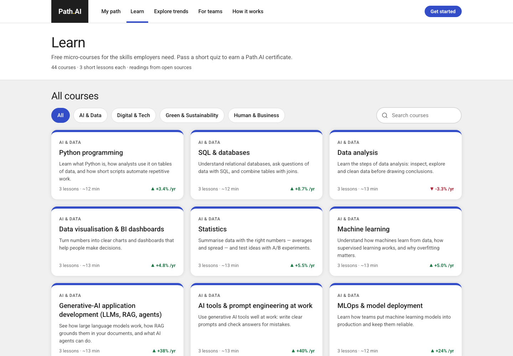
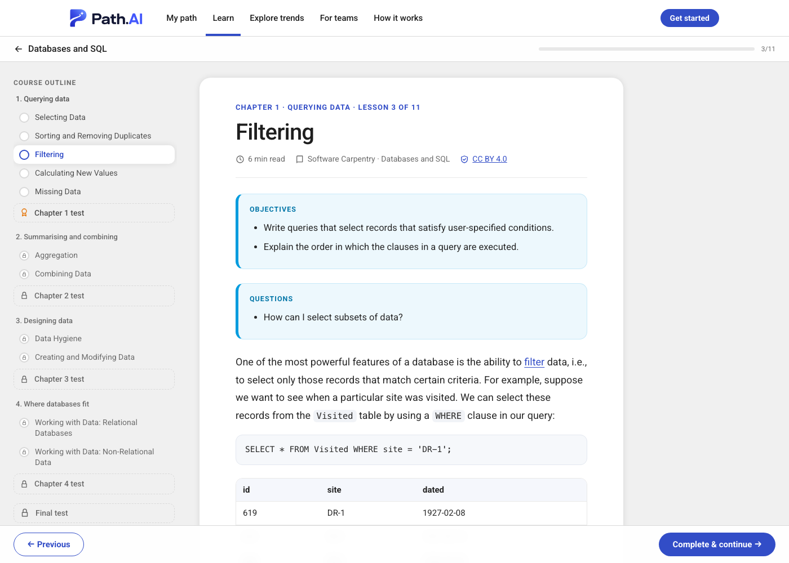
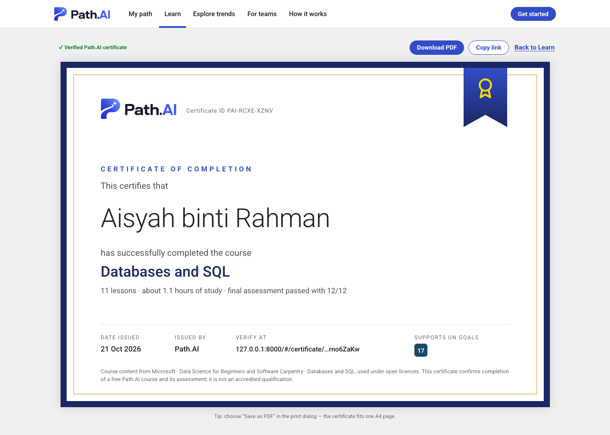

## Opportunities: a job or a university, anywhere

This is the last step of the journey. It is linked from the results, the plan, your own certificate and the menu. It asks two questions only: **study or work?** and **where?** You can search any country, and popular ones are one tap away. Answers stay in the browser, and the profile is sent with each request, as on the results page. The country only sets where to look; it never changes the role ranking.

**Work**
- **The jobs.** A dated snapshot of **19,481 open postings in 94 countries**. 6,376 of them can be done remotely, 190 of those from anywhere. Only public, documented sources are used:
  - company career pages on Greenhouse, Lever and Ashby (207 employers);
  - Hacker News *Who is hiring?*;
  - Himalayas, Jobicy, Remotive, Remote OK and Arbeitnow.

  We keep only each posting's title, company, link, place, date and level, plus the skills our catalogue detects in it. Descriptions are not stored. Every card names its source, and you always apply on the original page. The GeoNames gazetteer (CC BY 4.0) maps each place to a country.
- **The match.** Scoring is the same explainable method as the role matches. Each posting is recognised as one of the 63 catalogue roles from its title, and blended with the hard skills its text asks for.
  - A Path.AI certificate counts as a working-level skill.
  - Each card lists the skills you have and the ones you are missing, with hours to learn and a link to the Path.AI course.
  - Without a profile yet, the newest postings for the chosen direction are shown, unscored.
- **Filters.**
  - *In <country>* or *Remote*.
  - Level: entry and internships, mid or senior.
  - Direction: the role whose plan you opened, your best matches, and your current job.
  - *Remote — from anywhere* lists only postings open to applicants worldwide. A "remote, US only" job does not count.
- **Job sites.** Each country gets pre-filled searches for your direction:
  - official public portals first: MYFutureJobs, MyCareersFuture, GOV.UK Find a job, Job Bank, Bundesagentur für Arbeit, EURES, USAJOBS, Hello Work;
  - then JobStreet, SEEK, Indeed, Naukri and LinkedIn.

  These are links only. Sites without a public API are never scraped.

**Study**
- **Universities.** 219 countries, from Wikidata (CC0) and the Hipo university list (MIT). Each list is ordered by how many Wikipedia language editions describe the institution. That is a rough, open sign of how widely known it is, **not a ranking**: QS and THE are linked, not copied.
- **Degree fields.** 32 fields, mapped from the person's direction and field of study. *Find programmes* searches each university's own website for the chosen field.
- **How to apply and funding.** Checked links to official admission and scholarship portals for 17 popular destinations:
  - Malaysia: UPU, EMGS, PTPTN;
  - UK, US and Australia: UCAS, Chevening, Common App, Fulbright, Australia Awards;
  - Europe: DAAD, uni-assist, Studielink, Campus France;
  - Asia and Türkiye: MEXT, Campus China, Türkiye Scholarships;
  - and more, plus Erasmus Mundus for EU countries.
- **Prepare now.** Free Path.AI courses that give a head start in the chosen field.

**Data pipeline.** Rebuild with `python -m scripts.opportunities.jobs` (about 15 minutes, polite and cached) and `python -m scripts.opportunities.universities`. Sources and terms are in `data/opportunities/LICENSE.md`.

**Flags.** Country flags are small SVG images from [flag-icons](https://github.com/lipis/flag-icons) (MIT), kept in `static/flags/`. Windows has no colour flag emoji, so emoji flags would show up there as letters such as "MY".

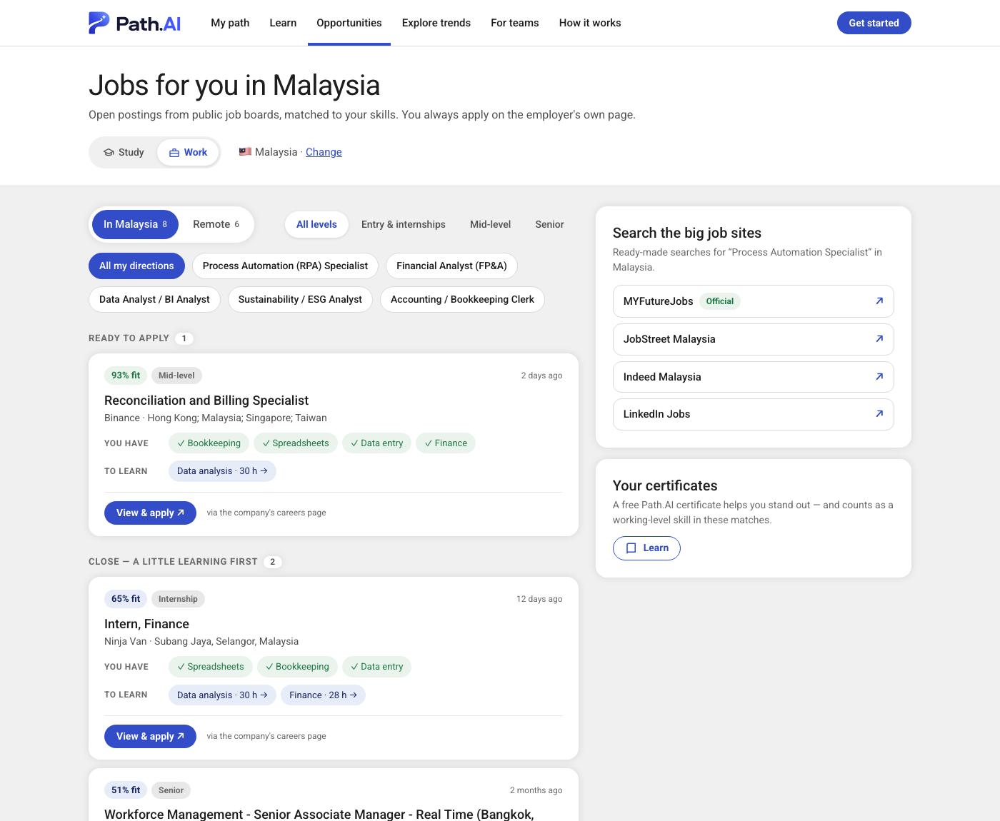
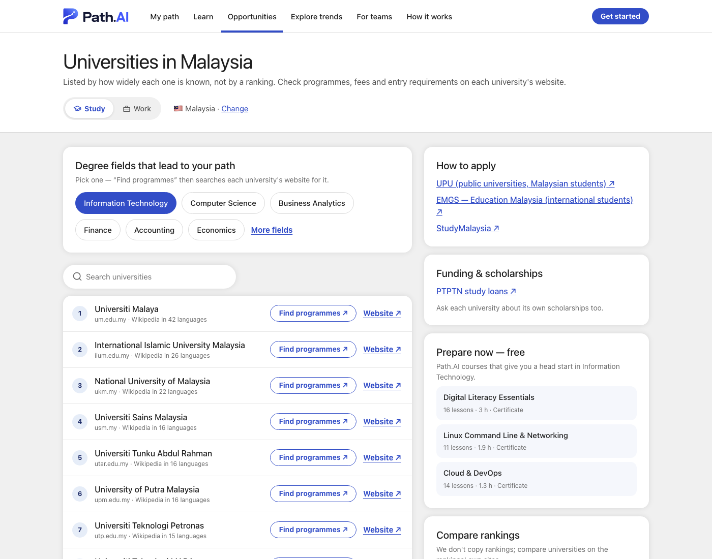

## Guardrails: nothing is invented

- **Jobs** come only from `roles.json` (O*NET codes and WEF categories).
- **Courses** come only from `resources.json`, where every URL is checked by `scripts/verify_resources.py`. If no course exists, the plan says *"No verified course in our list yet — ask a career counsellor"*.
- **The LLM never chooses jobs, courses or numbers.**
  - CV reading is JSON-schema constrained to our skill ids, and each skill must quote the CV verbatim or it is dropped.
  - Explanations must cite existing sources and may contain only numbers from the fact sheet; otherwise the verified text is shown.
  - Both rules are tested against a fake vLLM endpoint (`tests/test_guardrails.py`).
- **Fairness.** The only inputs are skills, interests, SDG priorities and weekly hours. A test proves that adding age, gender, ethnicity or location cannot change the ranking. The country chosen under *Opportunities* only filters where to look for jobs or universities.
- **Human-centred.** Every skill can be edited and the ranking re-weighted. Path.AI supports career decisions; it does not make hiring decisions.

## Language model and GPU

- **Model.** `Qwen/Qwen3.8-27B-FP8`: open weights (Apache-2.0, Aug 2026), multilingual (EN/BM/ZH), vision-capable, fits one 48 GB GPU.
- **GPU.** 1× **RTX A6000 48 GB** on RunPod: $0.59/h Secure, $0.33/h Community, about 40 hours for $25.
- **Without the model.** The app works fully **without** it. Only CV reading and the *Rewrite with AI* explanations use it.
- **Details.** Reasoning, alternatives, budget plan and setup are in **[docs/RUNPOD.md](docs/RUNPOD.md)**.

## Hardest risks and fallbacks

| Risk | Mitigation |
|---|---|
| Trend data unreliable or unavailable during the demo | Signals are cached in the repo with fetch dates. Refresh is incremental and keeps the last good data on failure. There are two independent live sources plus cited baselines, and OpenAlex use is budget-aware. |
| AI inventing jobs, courses or statistics | Catalog-only ids, evidence and number guardrails, and tests. |
| Matching quality | Transparent components, transferable-skill credit, editable skills and weights, and robustness across scenarios. |
| GPU or LLM down | Full rule-based mode. The UI states which engine wrote each explanation. |
| Representativeness (HN is US/tech-centric) | Used for tech skills only, with confidence labels. Malaysian feeds are on the roadmap. |
| Few open postings for a country in the job snapshot | Every country also gets one-tap searches on its main job sites, official portals first, and remote jobs open worldwide. |

## Run it

```bash
python3 -m venv .venv && source .venv/bin/activate      # Python ≥ 3.11
pip install -r requirements.txt
uvicorn app.main:app --reload                            # http://127.0.0.1:8000
python -m pytest -q                                      # 76 tests
python -m app.signals.refresh                            # pull fresh HN + OpenAlex data (optional)
python scripts/verify_resources.py                       # re-check every course / source URL
python -m scripts.opportunities.jobs                     # refresh the job snapshot (about 15 min)
python -m scripts.opportunities.universities             # refresh the university lists
uv run --with markdown-it-py --with mdit-py-plugins --with nh3 --with beautifulsoup4 --with lxml --with pyyaml python -m scripts.learnkit.build  # rebuild the courses
```

- **Replit.** Import the GitHub repo. `.replit` installs the requirements and runs uvicorn on port 8000.
- **LLM.** Copy `.env.example` to `.env` and set `LLM_BASE_URL`, `LLM_API_KEY` and `LLM_MODEL`.
- **Certificates.** In production, set a stable `CERT_SECRET`.

**Demo links** (one tap to a full result):

| Link | Opens |
|---|---|
| `/#/results?persona=aisyah` | Accounts clerk → automation, finance and data roles |
| `/#/results?persona=weijie` | Engineering graduate → EV, solar and renewable-energy roles |
| `/#/results?persona=kavitha&pace=fast` | Contact-centre lead, under fast AI disruption |
| `/#/results?persona=arif` | Production operator at an electronics plant → automation, quality and semiconductor roles |
| `/#/plan/automation_specialist?persona=aisyah` | A full learning plan |
| `/#/learn` · `/#/learn/sql` · `/#/learn/sql/sql-03` · `/#/learn/sql/test-1` · `/#/learn/sql/final` | Course catalogue · course page · lesson player · chapter test · final test |
| `/#/next?persona=aisyah&mode=work&country=MY` | Open jobs in Malaysia for an accounts clerk, with fit, gaps and job-site searches |
| `/#/next?persona=weijie&mode=study&country=DE` | Universities in Germany for an engineering graduate, with DAAD and Erasmus links |
| `/#/next?mode=work&country=REMOTE` | Remote jobs open to applicants worldwide |
| `/#/trends?asof=2025-10` | Trends as of an earlier month (time machine) |
| `/#/teams` | HR heatmap |
| any link + `&lang=ms` or `&lang=zh` | Same page in Bahasa Melayu or 中文 |

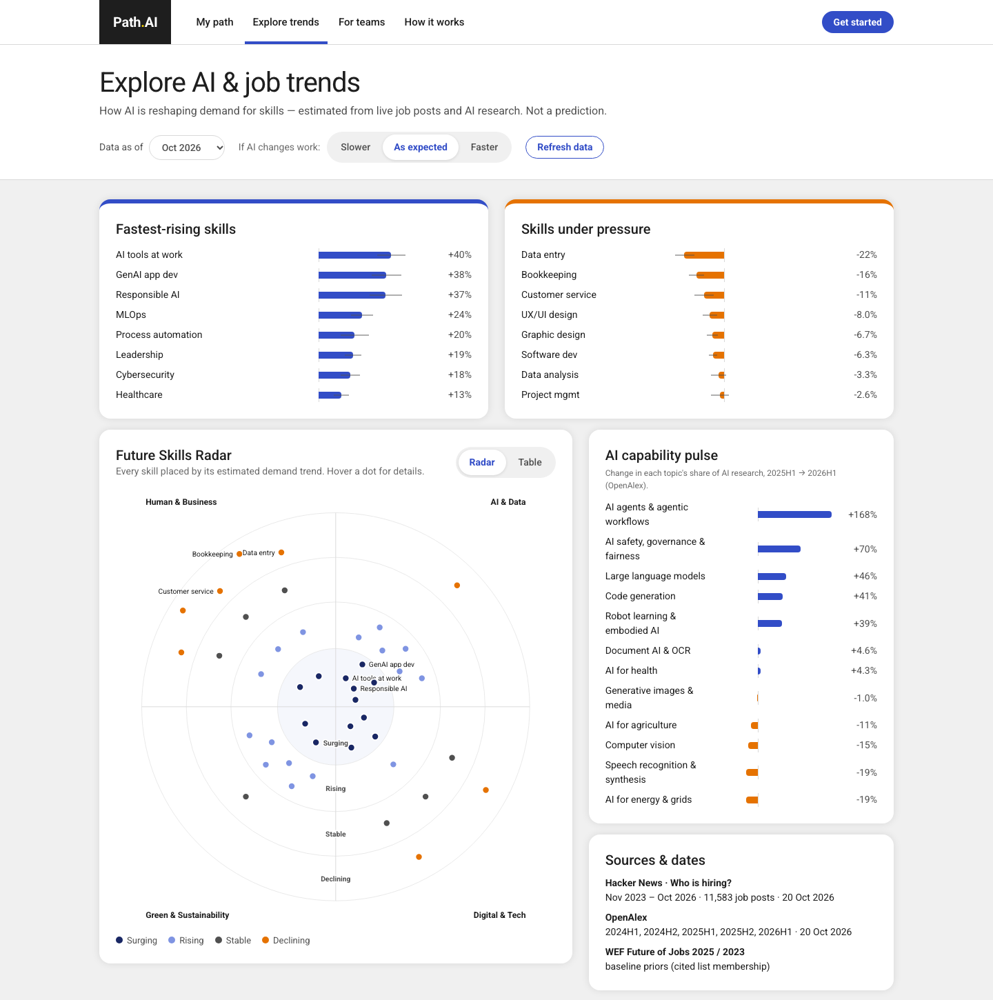

## Project structure

```
app/
  main.py              FastAPI API + static web app
  catalog.py           loads & validates the curated catalogs
  signals/             live sources: hn.py (job posts), openalex.py (AI research), refresh.py
  engine/              forecast.py · matching.py · pathway.py · explain.py · profile.py
  llm/                 OpenAI-compatible client (vLLM / RunPod) + guarded tasks
  learn.py             full courses, lessons, chapter and final tests graded on the server, signed passes and certificates
  opportunities.py     jobs matched to a profile by country / remote, universities by country, job-site and study links
data/
  catalog/             skills · roles (+ interest tiles, study fields) · resources · sdgs · capabilities · sources
  signals/             cached, dated trend data (refreshable)
  learn/               courses/*.json (syllabus + question pool) · lessons/<skill>/*.html (sanitised lesson text) · quizzes/*.json (authored questions) · pins.json · LICENSE.md
  opportunities/       jobs.json (dated job snapshot) · universities.json · portals.json · fields.json · sources.json · LICENSE.md
  personas.json        fictional example people + fictional HR team
static/                vanilla-JS single-page app (no build step): app.js · learn.js · next.js · core.js · charts.js · i18n.js · styles.css · brand/ (logo, icons) · flags/ (country flags, MIT)
scripts/learnkit/      course importer: courses.py (which open material each course uses) · build.py · convert.py · digest.py
scripts/opportunities/ job and university snapshots: jobs.py · universities.py · places.py (GeoNames) · fetch.py (polite cached GETs)
scripts/brand_assets.py  rebuilds static/brand/ (vector logo, favicons, link preview) from the master logo
tests/                 catalog, engine, guardrail, learn/certificate, opportunities and API tests
docs/RUNPOD.md         model + GPU choice and deployment guide
```

## Limitations and roadmap

- Malaysian job-posting feeds (e.g. MYFutureJobs / MyMahir partnerships), DOSM labour statistics and HRD Corp programme data, so that non-tech skills also get live market signals.
- Research attention is a proxy for AI progress, not a measure of real-world adoption. Adoption signals could be added.
- Sensitivities are expert assumptions. They should be calibrated against observed job-post changes as more history accumulates.
- Role summaries and lessons are English-only for now. Image-CV intake is possible because the model is vision-capable.
- Course text is English (the language of the open sources); the interface is in English, Malay and Chinese. Some courses are reading-heavy and could gain hands-on labs.
- The job snapshot leans towards tech and international employers. Malaysia has 166 on-site postings plus remote ones, so one-tap searches on local job sites carry much of the load. A Malaysian feed would fill the gap, for example MYFutureJobs through a partnership.
- Roles are recognised from posting titles with patterns. Postings whose titles match no catalogue role are scored on their skills alone, at a discount.
- Universities are ordered by how widely they are known, which is not a measure of quality or fit. Programme-level data, such as courses, fees and entry grades, would need each country's official sources.

## Data and AI disclosure

- **Data.** Public or open data and fictional example people only. No real CVs or personal data are stored. Trend job posts are kept as aggregate counts only. The Opportunities snapshot keeps each posting's facts (title, company, link, place, date and detected skills) but not its description. Its sources and terms are in `data/opportunities/LICENSE.md`. Lesson texts are openly licensed materials, shown with source and licence on every lesson (see `data/learn/LICENSE.md`).
- **Language model.** Qwen3.8-27B (open weights) when configured. Otherwise the app runs fully rule-based, and the UI says which engine wrote each explanation.
- **Estimates.** All forecasts are estimates, not predictions. People decide.
